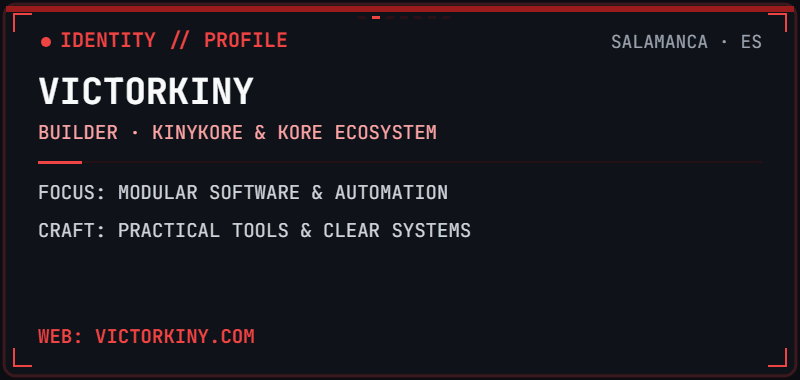
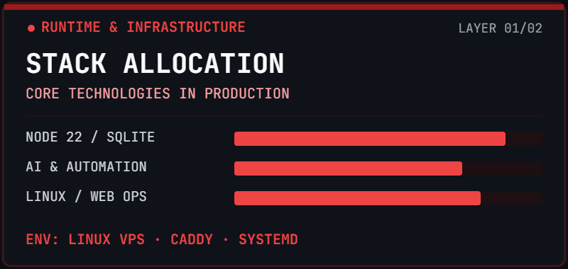
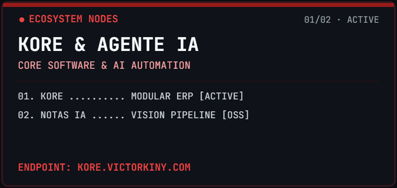

### `VICTORKINY // KINYKORE`

**[WEB](https://victorkiny.com/)** · **[KORE](https://kore.victorkiny.com/)** · **[X](https://x.com/victorkinyVK)** · **[YOUTUBE](https://www.youtube.com/@victorkiny)**

  
  

  
  

---

### `SYSTEMS & ARCHITECTURE`

* **KORE:** Modular self-hosted operations ERP (`Node.js 22`, `SQLite WAL`, `systemd`, `Caddy`).
* **Agente de Notas IA:** Automated pipeline routing captured notes to Calendar, Tasks, and Sheets (`Google Apps Script`, `Gemini API`).
* **KINY3D:** Functional CAD design, slicing, and 3D-printed hardware workflows (`Fusion 360`, `Bambu Studio`, `PLA / PETG / ABS / ASA`).
* **AJ Motors:** Workshop web presence and self-hosted deployment (`WordPress`, `Linux VPS`).

# ⚡ Software Developer & Autonomous Systems Architect

> Enfoque estricto en rendimiento crítico, arquitecturas modulares y control absoluto del dato. Desarrollos orientados y servidos desde **<a href="https://victorkiny.com/" target="_blank" rel="noopener noreferrer">victorkiny.com</a>** — Salamanca, España.

---

### 🏛️ Core Ecosystem & Projects

| Proyecto | Descripción Técnica | Stack / Estado |
| :--- | :--- | :--- |
| **<a href="https://victorkiny.com/#kore" target="_blank" rel="noopener noreferrer">KORE</a>** | Sistema modular de gestión operativa (CRM, agenda, facturación). | Producción / Privado |
| **<a href="https://github.com/victorKINY/Agente-de-Notas-Foto-IA" target="_blank" rel="noopener noreferrer">Agente de Notas IA</a>** | Pipeline con visión por computador para clasificación automática. | Open Source |
| **<a href="https://kiny3d.com" target="_blank" rel="noopener noreferrer">KINY3D</a>** | Ecosistema de ingeniería aditiva e impresión 3D automatizada. | En Lanzamiento |
| **<a href="https://ajmotorssalamanca.com" target="_blank" rel="noopener noreferrer">AJ Motors</a>** | Arquitectura web de ultra-rendimiento para taller mecánico local. | Producción |

---

### 💻 Technical Stack & Infrastructure

* **Languages & Core:** `JavaScript` `Node.js` `Python`
* **Data & Storage:** `SQLite (WAL mode)` `Isolated Local Architectures`
* **Automation & IA:** `n8n` `Anthropic Claude API` `Google Gemini API` `Google Apps Script`
* **Infrastructure:** `Linux VPS` `Git` `Replit` `Optimized WordPress / WooCommerce`

---

### 🌐 Direct Links & Core Web

* **Web Principal:** **<a href="https://victorkiny.com/" target="_blank" rel="noopener noreferrer">victorkiny.com</a>** *(Plataforma central de servicios y despliegues)*
* **Comunidad / Soporte:** <a href="https://discord.gg/stwTKAw" target="_blank" rel="noopener noreferrer">Discord (Chachitos Mafia)</a>
* **Canales Técnicos:** <a href="https://github.com/victorKINY" target="_blank" rel="noopener noreferrer">GitHub</a> · <a href="https://x.com/VictorKinyVK" target="_blank" rel="noopener noreferrer">X (@VictorKinyVK)</a> · <a href="https://www.youtube.com/user/victorkiny" target="_blank" rel="noopener noreferrer">YouTube</a>
