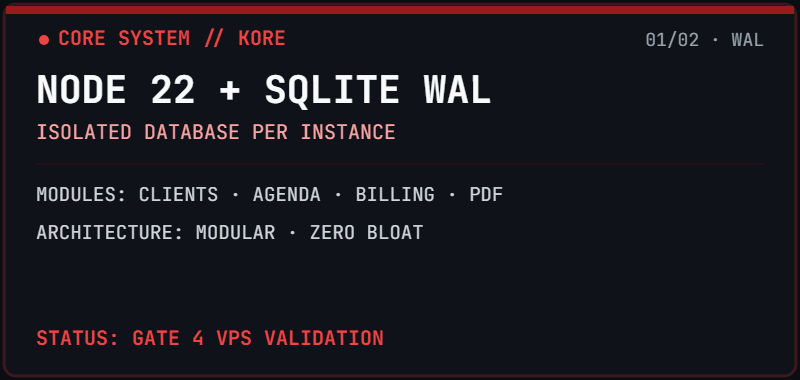

### `VICTORKINY // KINYKORE`

<a href="https://victorkiny.com/"><code>[ WEB ]</code></a>
<a href="https://kore.victorkiny.com/"><code>[ KORE ]</code></a>
<a href="https://x.com/victorkinyVK"><code>[ X ]</code></a>
<a href="https://www.youtube.com/@victorkiny"><code>[ YOUTUBE ]</code></a>

  
  

  
  

---

### ⚡ Software Developer & Autonomous Systems Architect

> Enfoque estricto en rendimiento crítico, arquitecturas modulares y control absoluto del dato. Desarrollos orientados y servidos desde **[victorkiny.com](https://victorkiny.com/)** — Salamanca, España.

---

### 🏛️ Core Ecosystem & Projects

| Proyecto | Descripción Técnica | Stack / Estado |
| :--- | :--- | :--- |
| **[KORE](https://kore.victorkiny.com/)** | Sistema modular de gestión operativa (CRM, agenda, facturación). | Producción / Privado |
| **[Agente de Notas IA](https://github.com/victorKINY/Agente-de-Notas-Foto-IA)** | Pipeline con visión por computador para clasificación automática. | Open Source |
| **[KINY3D](https://kiny3d.com)** | Ecosistema de ingeniería aditiva e impresión 3D automatizada. | En Lanzamiento |
| **[AJ Motors](https://ajmotorssalamanca.com)** | Arquitectura web de ultra-rendimiento para taller mecánico local. | Producción |

---

### 💻 Technical Stack & Infrastructure

- **Languages & Core:** `JavaScript` `Node.js` `Python`
- **Data & Storage:** `SQLite (WAL mode)` `Isolated Local Architectures`
- **Automation & AI:** `n8n` `Anthropic Claude API` `Google Gemini API` `Google Apps Script`
- **Infrastructure:** `Linux VPS` `Git` `Replit` `Optimized WordPress / WooCommerce`
